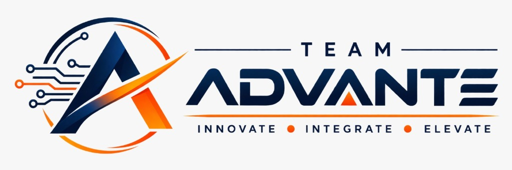

# 🏛️ ADVANTE | Automated Geospatial Harmonization & Cadastral WebGIS

<div align="center">
  

  <p><strong>Smart India Hackathon 2026 • Problem Statement ID: 26013</strong></p>
  <p><em>Automated Integration and Intelligent Harmonization of Multi-source Geospatial Data for Urban Land Record Management</em></p>

  <div>
    
    
    
    
  </div>
</div>

---

## 📌 Executive Summary

**ADVANTE** is an enterprise-grade AI-powered Geospatial Harmonization and Cadastral WebGIS platform designed for the **Department of Land Records (Bhumilekhan), Government of Maharashtra**. 

The platform resolves deep-rooted discrepancies between satellite orthoimagery (Cartosat-3 / Sentinel), legacy paper cadastral survey maps, and revenue land record registers (Form 7/12 RoR, Property Cards, and e-Chawadi). It establishes a single, verified **Golden Land Record** per cadastral parcel with sub-centimeter geometric precision.

---

## 🌟 Key Capabilities & Features

### 1. 🗺️ MahaBhuNakasha Live GIS Integration
- **Full WMS & REST Proxy**: Real-time integration with Maharashtra's official BhuNaksha portal (`VILLAGE_MAP` and `PLOT_LIST` layers).
- **Comprehensive Coverage**: Covers all **36 Districts**, **358+ Talukas**, and **43,665 real Maharashtra villages** with 13.8M+ cadastral survey parcels.
- **Translucent Ground Visibility**: Calibrated layer blending (26% opacity) that highlights parcel boundaries while keeping ground soil, vegetation, roads, and buildings 100% visible beneath.
- **Intelligent Click-to-Identify**: Optional on-demand identify mode that detects clicked coordinates, marks the land parcel, and auto-fills administrative hierarchy and survey numbers.

### 2. 👥 Real Village Demographics & Ground Truth
- **Census 2011 Synchronization**: Complete synchronization of village populations, household counts, and geographic extents in hectares.
- **Cadastral Extent Ratios**: Live calculation of population density per km², land allocation per rural household, and average family density.
- **District Cadastral Progress**: Pre-computed digitization coverage for all 36 districts.

### 3. 📂 Dedicated Village Cadastre Directory
- **Dedicated Directory Page**: Accessible via the navigation sidebar under *Nakasha Intelligence*.
- **Official Cadastre Dossier**: Inspection dossiers for any selected village, featuring Census 2011 Code, MahaBhuNakasha WMS Code, and Land Use Classifications (Agricultural, Forest/CFR, Gaothan Abadi).
- **Real-Time Village Table**: Filterable and searchable table of real Maharashtra villages with direct *Locate* and *Report* actions.

### 4. 📊 Territorial Analytics & Bhumilekhan Document Center
- **Interactive 7-Stage Pipeline Flowchart**:
  1. `Satellite & Aerial Ingest` (Cartosat-3 / Sentinel Orthoimagery)
  2. `BhuNaksha Vector Boundary Extraction` (WMS / Shapefiles)
  3. `Bhumilekhan 7/12 RoR Parsing` (e-Chawadi Register)
  4. `AI Boundary Harmonization Engine` (Spatial Edge-Snapping & Topology)
  5. `Discrepancy & Dispute Detection` (Overlap & Conflict Audit)
  6. `Revenue Officer Digital Endorsement` (DILR / Talathi Signing)
  7. `Citizen & Departmental WebGIS Publish` (Live Endpoints & GeoPDF)
- **Visual Distribution Charts**: Pie charts for land classification and donut charts for golden record reconciliation status.
- **Statutory Document Downloads**:
  - **Bhumilekhan Cadastral Survey Dossier**: Official Government of Maharashtra print-ready document with state emblem, village demographics, and DILR seal.
  - **Form 7/12 RoR Extract**: Statutory land record summary downloadable as CSV.
  - **Quality Audit Certificate**: Geospatial mathematical validation sheet downloadable as GeoJSON.

---

## 🛠️ Technology Stack

| Layer | Technologies |
|---|---|
| **Frontend Framework** | React 19, TanStack Start, TanStack Router |
| **Geospatial & WebGIS** | OpenLayers 10, Leaflet, GeoJSON, EPSG:3857, EPSG:4326, EPSG:32643 |
| **Styling & UI** | Tailwind CSS v4, Lucide React Icons |
| **Server & Data Engine** | Node.js, Vite, Reverse-Geocoding Proxy, MahaBhuNakasha WMS Session Engine |
| **Data Ground Truth** | Maharashtra Village Index (43,665 entries), Census 2011 Master Register |

---

## 📁 Repository Structure

```text
├── public/                     # Static assets & GIS data
│   ├── data/                   # Maharashtra district boundaries & village index
│   │   ├── mh_districts.geojson
│   │   ├── mh_talukas.geojson
│   │   └── village_index.json  # 43,665 real Maharashtra villages
│   ├── advante_icon.png        # Team Advante brand icon
│   ├── favicon.svg             # Vector favicon
│   └── team_advante_logo.jpg   # Official Team Advante emblem
├── src/
│   ├── components/             # Reusable UI & WebGIS components
│   │   ├── NakashaMap.tsx      # MahaBhuNakasha OpenLayers WebGIS engine
│   │   ├── UrbanHarmonizationDashboard.tsx # Executive Officer Dashboard
│   │   ├── VillageCadastreDirectoryPage.tsx # Cadastre Directory & Map Dossier
│   │   ├── TerritorialAnalyticsPage.tsx     # Flowchart, Pie Charts & Documents
│   │   └── OfficerLoginModal.tsx # Revenue Officer Authentication Modal
│   ├── lib/                    # Geospatial & analytical business logic
│   │   ├── real-nakasha-analytics.ts # Census 2011 & 36 districts data engine
│   │   ├── mh-village-data.ts        # Village search & indexing algorithms
│   │   └── error-reporting.ts        # System diagnostics & error boundary
│   ├── routes/                 # TanStack file-based routes
│   │   ├── __root.tsx          # HTML shell, metadata, and branding
│   │   └── index.tsx           # Main application view switcher
│   └── styles.css              # Design system & cadastral glassmorphism styles
├── docs/                       # Project documentation & presentations
│   ├── presentations/          # Pitch decks, presentations, and competition formats
│   └── specifications/         # Architectural specs, prompt engineering & technical briefs
├── resources/                  # External datasets & multimedia resources
│   ├── datasets/               # Survey CSVs, GeoJSON files, and training sources
│   └── media/                  # Demonstration recordings and project imagery
├── vite.config.ts              # Vite & WMS proxy server configuration
├── tsconfig.json               # TypeScript configuration
└── package.json                # Project dependencies & scripts
```

---

## 🚀 Quickstart & Local Development

### Prerequisites
- **Node.js**: v18.0.0 or higher
- **npm** or **bun**

### Installation

```bash
# 1. Clone repository
git clone https://github.com/AyushSahare964/urban-land-connect.git

# 2. Navigate to directory
cd urban-land-connect

# 3. Install dependencies
npm install

# 4. Start local development server
npm run dev
```

Open [http://localhost:8080](http://localhost:8080) in your browser.

### Default Officer Credentials
- **Username**: `officer`
- **Password**: `officer123`

---

## 👥 Team ADVANTE • Smart India Hackathon 2026

- **Problem Statement**: PS 26013 (Automated Integration and Intelligent Harmonization of Multi-source Geospatial Data for Urban Land Record Management)
- **Organization**: Ministry of Housing and Urban Affairs / Department of Land Resources
- **Motto**: *Innovate • Integrate • Elevate*
